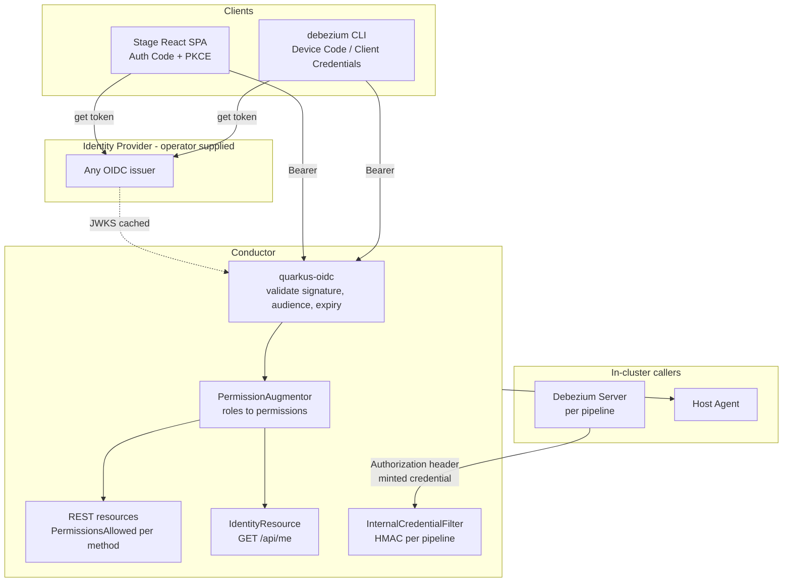

# DDD-79: Identity and Access Management for the Debezium Platform

**Status:** Proposed

## Motivation

The platform shipped optional OIDC bearer-token validation on the conductor in 3.7 [(dbz#2306)](https://github.com/debezium/dbz/issues/2306), and single sign-on works today for the browser: put an authenticating reverse proxy such as oauth2-proxy in front of the platform, and it terminates the login flow and injects `Authorization: Bearer` upstream. That path is documented and demonstrated.

What is missing is everything around it.

The proxy is an external component the project neither ships nor charts, so every operator assembles and supports it themselves, including a brittle coupling the blog post has to warn about, where a cookie refresh interval set above the access-token lifespan produces a UI that loads and then fails every API call. Even when it works, the stage UI remains identity-blind: it never learns who the user is, so there is no user name and no working sign-out. The `debezium` CLI cannot authenticate in **any** deployment topology, without a proxy it receives 401, and with one in reverse-proxy mode it receives an HTML login page, because the proxy fronts `/api/` as well as the UI.

Most consequentially, there is no authorization at all. Any valid token from the realm has full create, read, update and delete access to every resource in the platform. An analyst who should only be able to look at pipelines can delete them. dbz#2306 stated this plainly, "no RBAC in this branch yet", and it has not changed since.

This document proposes completing identity and access management natively: the UI and the CLI authenticate on their own, every API operation is gated by a permission, and the platform's own internal callers get real identities instead of a network heuristic.

## Goals

Primary objectives:

1. Let the stage UI authenticate without an external proxy, and show the signed-in user with a working sign-out.
2. Let the `debezium` CLI authenticate, both interactively for humans and non-interactively for CI and the forthcoming MCP server.
3. Gate every API operation on a named permission, with roles as deployment-configurable bundles of permissions so organisations keep their existing role vocabulary.
4. Give the platform's internal callers, Debezium Server notification callbacks and the host agent, real credentials rather than network heuristics or fail-open defaults.
5. Keep the whole feature optional and off by default, so local development, demonstrations and evaluation are unaffected.
6. When it is on, have it on everywhere: no partial enforcement, no development bypass, no component that falls back to permitting access.

Non goals for this phase:

- **No resource ownership and no multi-tenancy.** Authorization is by role across a shared catalogue. Scoping resources to the user who created them, or isolating tenants, requires schema changes and is deliberately separate.
- **No user or role administration in the platform.** Identity administration belongs to the identity provider. The platform reads claims and offers no screen for creating users or assigning roles.
- **No audit trail.** Recording which principal performed each mutating action is valuable but needs the same schema additions as ownership.
- **No platform-issued API tokens.** Long-lived tokens minted and revoked by the platform would duplicate the identity provider and make the platform an identity provider itself.
- **No adoption of an authenticating proxy.** It remains a perfectly good deployment pattern for operators who already run one, and continues to work, but it is not the product's answer.

## Proposed Solution

Four parts, built on what already ships rather than replacing it. **The authentication mechanism does not change**: the conductor remains an OIDC resource server in `service` mode. What changes is that clients can now obtain tokens unaided, and that tokens now carry meaning beyond "authenticated".

1. **Clients obtain their own tokens.** Stage becomes an OIDC public client using Authorization Code with `PKCE`. The CLI uses the Device Authorization Grant for humans and client credentials for automation. Both talk directly to the identity provider; the conductor is not involved in any login flow.
2. **Roles become permissions.** The conductor resolves the role names in a validated token into a set of permissions, using a mapping supplied as deployment configuration. Tokens stay small and stable, and identity administrators never need to know what a platform permission is.
3. **Every operation declares a permission.** REST methods are annotated, and an operation without a declaration is denied rather than permitted, enforced by a test, so a new endpoint cannot ship unprotected.
4. **Internal callers get credentials.** Debezium Server presents a per-pipeline credential the conductor minted for it, and the host agent's shared token stops being optional.

No new infrastructure is introduced. There is no session store, no token store, no proxy and no new network path. The identity provider is operator-supplied and was already a prerequisite for the existing OIDC support.

A key design choice: **permissions are the unit of enforcement and roles are configurable bundles of them.** A role such as *operator*, may restart a pipeline and trigger a snapshot, may not change its configuration, cannot be expressed by mapping HTTP verbs onto tiers. It needs write-like actions without configuration writes, which is exactly what a permission model provides.

## Architecture



Flow in words:

1. A user signs in at the identity provider, in the browser or via the CLI's device code flow. The conductor plays no part. It only fetches signing keys, and caches them.
2. The client presents the resulting access token as `Authorization: Bearer` on every request. The conductor validates it locally against cached keys: no call to the identity provider on the request path.
3. The resulting identity carries role names. `PermissionAugmentor` resolves those roles to permissions using the configured mapping and attaches them to the identity. Roles the platform does not recognise contribute nothing and are not an error, organisations have roles unrelated to this platform.
4. The REST method's declared permission is evaluated against that set. A caller holding none receives a denial naming the permission they lack.
5. Internal callers take a separate path. Debezium Server presents a credential the conductor minted for that specific pipeline, verified by recomputing it; it never participates in OIDC.

### Deployment boundaries

- **Identity provider side:** two client registrations, a public `PKCE` client for stage, and a public device-grant client for the CLI. The conductor itself needs only the issuer URL to validate tokens. Role assignment is whatever the organisation already does.
- **Conductor side:** the permission catalogue, the role mapping, the augmentor, per-method annotations, the identity endpoint, the internal credential service and filter, and startup validation.
- **Debezium Server side:** one new configuration property carrying the credential. Nothing to build or mount.
- **Frontend and CLI side:** the login flows, token handling, and permission-aware rendering described below.

### Security note: the deviation from RFC 10017

RFC 10017 (*OAuth 2.0 for Browser-Based Applications*) ranks three architectures: backend-for-frontend first, token-mediating backend second, browser-only OAuth client third. **This design chooses the third**, and a reviewer should expect to see that justified rather than glossed.

The reasons are a single token model across browser, CLI and CI rather than two code paths to secure; preserving the independent deployment of stage and conductor, which are separate repositories and separate workloads; an unchanged local development loop; and avoiding CSRF handling on a JSON API. A backend-for-frontend would additionally require the conductor to serve the UI's assets or share a cookie domain, which is a packaging change rather than a configuration one.

Because of that choice the compensating controls are load-bearing rather than optional: the access token lives in memory only and is never persisted, access-token lifetimes are short, refresh tokens are one-time-use with rotation, and the UI is served with a strict Content-Security-Policy. **In-memory storage does not defeat XSS**: script running on the page can read variables, hook requests, or silently obtain a fresh token through the live identity-provider session, so the CSP is what reduces the chance of hostile script running at all.

If the platform is later deployed for regulated data, the proportionate escalation is a service-worker token store rather than a move to a backend-for-frontend, since it preserves the properties above.

## Backend Components (Overview)

Responsibilities rather than implementation detail.

- **PermissionAugmentor** (conductor): resolves the role names on a validated identity into permissions via the configured mapping, and attaches them. Plays no part when the feature is disabled.
- **RoleMappingProvider** (conductor): the lookup behind the augmentor. Configuration-backed in this phase; the indirection exists so a database-backed mapping with an administration screen can be added later without touching the augmentor, the catalogue, the annotations or any enforcement path.
- **PermissionCatalogue** (conductor): the closed set of permission names. Being closed is what lets a typo in configuration be rejected at startup with a suggestion, rather than silently granting nothing.
- **AuthorizationController** (conductor): a ten-line bean that reports whether authorization is active. Quarkus consults it in both the HTTP path-policy layer and every annotation interceptor, so one switch disables both. There is no second enforcement path that could diverge from the first.
- **EnforcementValidator** (conductor): refuses to boot on any configuration that would enforce partially, and logs the active mode unmissably on every start.
- **IdentityResource** (conductor): reports who the caller is, what they may do, and whether the feature is enabled at all.
- **InternalCredentialService / InternalCredentialFilter** (conductor): mints and verifies the per-pipeline notification credential, replacing a network-provenance heuristic with an identity check.

## API Reference

### 1. Caller identity and capability

```
GET /api/me
-> 200 application/json
```

Requires authentication but no permission, any authenticated caller may ask who they are.

```json
{
  "iamEnabled": true,
  "subject": "f81d4fae-7dec-11d0-a765-00a0c91e6bf6",
  "username": "alice.martin",
  "email": "alice.martin@mycompany.com",
  "roles": ["dmp-editor", "finance-team"],
  "permissions": [
    "source:read", "source:write", "destination:read", "destination:write",
    "pipeline:read", "pipeline:write", "pipeline:operate", "pipeline:logs",
    "monitoring:read", "alert:read", "catalog:read"
  ]
}
```

With the feature disabled:

```json
{ "iamEnabled": false, "permissions": ["*"] }
```

Notes for rendering:

- **`iamEnabled` is load-bearing, not informational.** With the feature off there is no identity and no permission set, so a bare empty list cannot be distinguished from "authenticated but holding no permissions", and those must render very differently. Check this field before interpreting `permissions`.
- `roles` includes roles that have no mapping, such as `finance-team` above. This is deliberate and diagnostic: it answers "my token has the role, so why can I not do anything?" directly.
- The UI cannot compute permissions itself. The ID token tells it the user's *roles*, but the role-to-permission mapping is deployment configuration the browser has no visibility into.

### 2. Permission vocabulary

Seventeen permissions over nine resources. Every API operation requires exactly one.

| Resource | Actions | Covers |
|---|---|---|
| `source` | `read`, `write` | `/api/sources` |
| `destination` | `read`, `write` | `/api/destinations` |
| `transform` | `read`, `write` | `/api/transforms` |
| `connection` | `read`, `write` | `/api/connections`, including validation and schema browsing |
| `vault` | `read`, `write` | `/api/vaults` |
| `pipeline` | `read`, `write` | pipeline definitions |
| `pipeline` | `operate` | start, stop, signals, snapshot triggering, **not** configuration changes |
| `pipeline` | `logs` | logs and the live log stream |
| `monitoring` | `read` | metrics panels, snapshot progress and history |
| `alert` | `read`, `write` | alert rules and notification channels |
| `catalog` | `read` | the connector descriptor catalogue |

One rule is worth stating because it is not obvious: **an endpoint that initiates an outbound connection from user-supplied configuration requires the write permission of its resource, even when it persists nothing.** Connection validation, source signal verification and the notification-channel test all take a configuration and connect somewhere with it, which makes them usable to probe internal networks. They are write operations in every sense that matters.

### 3. Error semantics

Authentication and authorization failures must be distinguishable, and a denial must say what was missing:

```
401  not authenticated: no token, expired token, or invalid token
403  authenticated, but lacking the required permission (named in the response)
```

## Frontend / UI Requirements

The feature appears in four places.

### A. Sign-in and session

- An unauthenticated user visiting any page is redirected to the identity provider and returned to the page they originally asked for.
- Every API request carries the access token.
- The session is renewed transparently before the token expires. Expiry during an active session must not silently discard unsaved work.
- The access token is held **in memory only**. It is never written to `localStorage`, `sessionStorage`, or a cookie.
- Issuer and client id arrive at container start through the same runtime-injection mechanism already used for the conductor URL, so pointing the UI at a different identity provider needs no rebuild.

### B. User menu

Replaces the current placeholder avatar, which renders a hardcoded name and menu items with no handlers.

```
┌──────────────────────────────────┐
│  Alice Martin                    │
│  alice.martin@mycompany.com        │
│                                  │
│  Roles:  editor                  │
│ ──────────────────────────────── │
│  Sign out                        │
└──────────────────────────────────┘
```

- Shown only when the feature is enabled.
- Roles are displayed for diagnosis. They answer "why can I not do X?" without a support ticket.
- Sign-out clears local session state and ends the session at the identity provider.
- The placeholder "My profile" and "User management" entries are **removed**. The platform administers no identities.

### C. Permission-aware actions

Actions the caller cannot perform are not offered. Where hiding an action would be more confusing than showing it, disable it with an explanation instead.

```
  Pipeline: inventory-to-kafka                     [ Stop ]  [ Edit ⋯ ]
                                                      ▲         ▲
                                            pipeline:operate   pipeline:write
                                              (granted)        (not granted
                                                                → disabled,
                                                                  tooltip)
```

Tooltip: *"Requires the pipeline:write permission. Contact your platform administrator."*

**This is a usability measure and never the enforcement point.** The conductor denies regardless of what the UI renders.

### D. No access assigned

A user who authenticates successfully but holds no recognised role must see this, not an empty or broken application.

```
┌─────────────────────────────────────────────────────────────┐
│                                                              │
│                     No access assigned                       │
│                                                              │
│   You are signed in as alice.martin@mycompany.com, but no      │
│   platform role has been assigned to your account.           │
│                                                              │
│   Contact your platform administrator to request access.     │
│                                                              │
│                                        [ Sign out ]          │
└─────────────────────────────────────────────────────────────┘
```

### E. Disabled mode

When the feature is off, the default, and the case for local development and demonstrations, the UI shows **no login prompt, no user menu and no sign-out**, and behaves exactly as it does today. It detects this from an empty issuer in its injected configuration, and `/api/me` confirms it with `iamEnabled: false`.

### F. State handling summary

| Condition | UI behaviour |
|---|---|
| Feature disabled | No login, no user menu; everything permitted |
| Not authenticated | Redirect to the identity provider |
| Authenticated, permissions resolved | Normal operation, actions filtered by permission |
| Authenticated, no recognised role | "No access assigned" screen |
| Token expiring | Renewed transparently |
| Token expired | Re-authenticate, returning to the current page |
| `403` on an action | Explain the missing permission; do not present it as a generic failure |

## CLI Requirements

```
$ debezium login
Open the following URL in a browser to sign in:

    https://auth.mycompany.com/realms/dmp/device

and enter the code:  BXTD-QRLM

Waiting for authorization... done.

Signed in as alice.martin@mycompany.com (editor) on environment "production".
```

- **Device Authorization Grant** for humans: no local callback listener, so it works over SSH and inside containers.
- **Client credentials** for CI and the MCP server, configured by environment variable and persisting nothing.
- Credentials are stored per environment, consistent with the CLI's existing multi-environment configuration, so switching environments switches identity.
- `debezium whoami` reports the current identity, roles and effective permissions.
- Against a platform with the feature disabled, the CLI works with no credential and issues no prompts.

Failures must be distinguishable at a glance:

```
Error: not signed in to environment "production".
       Run `debezium login` to authenticate.

Error: permission denied. This action requires "vault:write".
       You are signed in as alice.martin@mycompany.com (editor).
```

## Permission Model and Role Bundles

Roles live in the identity provider; permissions live in the platform. The two meet at a role name, which is a string both sides already understand. An identity administrator never needs to learn what a platform permission is, and the platform never needs write access to the directory.

Shipped defaults, intended to be overridden with whatever role names an organisation already uses:

| Role | Permissions | Intent |
|---|---|---|
| **admin** | All | Full control, including vaults and alert channels |
| **editor** | All reads, plus writes on sources, destinations, transforms, connections and pipelines, plus `pipeline:operate` and `pipeline:logs` | Build and run pipelines. Cannot modify vaults or alert channels, both of which hold credentials |
| **operator** | All reads except `vault:read`, plus `pipeline:operate` and `pipeline:logs` | Day-two operations: restart a pipeline, trigger a snapshot, read logs, with no ability to change configuration |
| **viewer** | All reads except `vault:read` | Observe only |

A caller's effective permissions are the union across all their roles. Permissions apply identically to human and machine identities: a CI service account can hold any permission a person can.

**Why not have the identity provider issue permissions directly?** Keycloak composite roles could express these bundles natively, and it would avoid a restart when a bundle changes. It is rejected because composite roles are Keycloak-specific, Entra ID application roles are flat, Okta models this through groups, and because a platform release that adds a permission would then require every deployment's identity provider to be updated by a different team, with a silent failure if it is not. Mapping in the conductor means a new release ships new defaults and deployments inherit them.

## Lifecycle and Revocation

| State | Meaning |
|---|---|
| **Disabled** | Feature off; no authentication, no authorization, no identity |
| **Anonymous** | Feature on, no valid credential presented |
| **Authenticated** | Valid credential, permissions resolved |
| **Expiring** | Credential near expiry; renewed transparently |
| **Expired** | Re-authentication required |
| **Unauthorized** | Authenticated, but lacking the required permission |
| **No roles** | Authenticated, holding no recognised role |

**Access is re-evaluated at every credential renewal.** A user whose roles change, or who is removed from the directory, loses access at their next renewal rather than instantly, the exposure window is the access-token lifetime. Streaming connections are bounded rather than indefinite so that they too re-authenticate on reconnect, instead of persisting under a credential that was valid only at connection time.

Immediate revocation would require active signalling to terminate live sessions and streams, and is out of scope.

## Resilience (Summary)

- **Identity provider outages do not invalidate existing sessions.** Token signatures are verified against cached signing keys, so in-flight requests and established sessions continue while the cache remains valid. Only new sign-ins fail, which is unavoidable.
- **Key rotation** is handled by refetching when an unknown key identifier appears, rate-limited so a flood of invalid tokens cannot be turned into an attack on the identity provider.
- **Enabling the feature requires no data migration**, no resource recreation and no pipeline downtime. Existing pipelines keep running and have their notification credentials provisioned on next reconcile.
- **Misconfiguration fails fast.** The platform refuses to start rather than running half-enforced, because a platform that boots while believing itself protected is worse than one that does not boot.

## Internal Callers

Two callers cannot participate in OIDC, and both are handled without introducing a second identity system.

**Debezium Server notification callbacks.** The conductor mints a credential derived from a secret it holds and the pipeline's identity, and supplies it as ordinary pipeline configuration. Debezium Server presents it as an `Authorization` header on every notification. Because the pipeline identity is inside the derivation, a credential issued for one pipeline cannot be used to post notifications for another. Nothing is stored: verification recomputes and compares, so there is no table, no migration, and no database read on a path that runs on every chunk notification. Rotation is supported by accepting a previous secret during a window, so pipelines are re-provisioned at whatever pace suits the operator and no callback is ever rejected.

This replaces the current guard, which rejects requests carrying forwarding headers on the assumption they transited an ingress. That is a network guess rather than an identity check, and any in-cluster caller can bypass it.

**The host agent** keeps its shared token, but the token stops being optional: it currently disables authentication entirely when unset. Note that the agent is only reached in host deployment mode with the agent container runtime, and both settings default the other way, so the requirement applies to deployments that actually use the agent, not to every deployment.

## Configuration

Operator-facing configuration, with defaults:

| Property | Default | Description |
|---|---|---|
| `conductor.security.enabled` | `false` | The single switch. Governs authentication, authorization, internal credentials and the host agent token |
| `conductor.security.role-mappings` | the four bundles above | Role name to permission set. Role names are matched exactly against the token's role claims |
| `conductor.security.bootstrap-admin-role` | unset | Escape hatch: a role always granted all permissions, evaluated ahead of the mapping |
| `conductor.security.internal-credential.secret` | unset | Secret from which per-pipeline notification credentials are derived |
| `conductor.security.internal-credential.previous-secret` | unset | Accepted during a rotation window only; remove once all pipelines are re-provisioned |
| `quarkus.oidc.auth-server-url` | unset | Issuer URL. Required when enabled |
| `quarkus.oidc.token.audience` | unset | Expected audience. Empty disables the check |
| `quarkus.oidc.roles.role-claim-path` | unset | Needed only for providers that place roles outside the default locations |

**There is deliberately one switch.** `quarkus.oidc.tenant-enabled` is *derived* from `conductor.security.enabled` rather than configured alongside it, so authentication and authorization cannot be configured inconsistently. The existing `conductor.oidc.enabled` Helm value is honoured as a deprecated alias for one minor release; if both are set and disagree, startup fails rather than guessing which was meant.

## Prerequisites and Dependencies

**Pipeline log streaming must move from WebSocket to Server-Sent Events.** A browser cannot set an `Authorization` header on a WebSocket handshake, so this one endpoint would otherwise need a side-channel, a one-time ticket, which would have to be shared across conductor replicas and so introduces exactly the server-side state this design avoids. The stream is already strictly server-to-client: the endpoint declares no inbound message handlers and no client sends anything. Independently of this work, the conversion also supplies automatic reconnection, which the current implementation lacks entirely, and lets a missing pipeline return a proper error rather than rendering it as a line of log output.

**Debezium core: a configuration property setting the `Authorization` header on notification requests.** The HTTP notification channel exposes only `notification.http.url`, `.timeout.ms` and `.retries`, so Debezium Server currently has no way to authenticate its callback. The change is small, the channel's HTTP client already accepts a headers map, and what is missing is a field to populate one entry. A single property carrying the complete header value covers Bearer, Basic and API-key schemes without exposing a general header map, and is independently useful to anyone posting Debezium notifications to an authenticated endpoint.

**Credential exposure in pipeline configuration (dbz#2596).** Connection and component configuration currently carries credentials in plaintext, so a caller holding a read permission can read database passwords. This is addressed by the external secret store work, not by this document, but the ordering matters, and should be a conscious decision: if authorization ships first, a `viewer` role reads stored credentials from day one. The same work also externalises the notification credential described above, which until then is visible in the generated custom resource. That interim exposure is accepted deliberately: the credential permits only "post snapshot progress for this one pipeline", and sits in a resource that already contains far more valuable credentials.

## Future Enhancements (Out of Scope)

- Resource ownership: attributing resources to their creator and scoping visibility accordingly.
- Multi-tenancy: full tenant isolation. A breaking change, since resource names are globally unique today and would need to become unique per tenant.
- A role-mapping administration screen backed by a database table rather than configuration. Coherent, but it means releases can no longer evolve the default bundles without either clobbering customisation or leaving deployments silently stale.
- Audit trail: recording which principal performed each mutating action.
- Immediate revocation of live sessions and streams when a role is withdrawn.
- Delegating authorization decisions to an external policy engine. The permission model is a prerequisite for this, should it ever be wanted.
- A NetworkPolicy restricting in-cluster reachability of the conductor, which would also close the current ability to call it directly and bypass any ingress-level control.

## References

- [dbz#2306](https://github.com/debezium/dbz/issues/2306), optional OIDC bearer-token authentication for the conductor (closed; "no RBAC in this branch yet").
- [dbz#2422](https://github.com/debezium/dbz/issues/2422), the SSO blog post, which recorded that authorization was deferred pending this document.
- [dbz#2596](https://github.com/debezium/dbz/issues/2596) / [DDD-67](https://github.com/debezium/debezium-design-documents/pull/77), credentials management via an external secret store.
- [dbz#2412](https://github.com/debezium/dbz/issues/2412), CLI MCP server, both of which require the non-interactive credential path.
- [DDD-40](https://github.com/debezium/debezium-design-documents/pull/46), the Debezium CLI.
- RFC 10017, OAuth 2.0 for Browser-Based Applications.
- RFC 8628, OAuth 2.0 Device Authorization Grant.
- RFC 9700, Best Current Practice for OAuth 2.0 Security.
